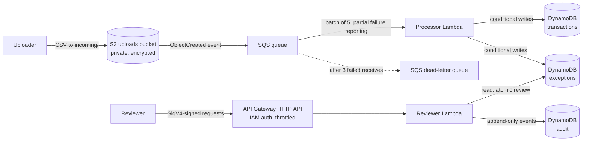

# Event-Driven Exception & Reconciliation Platform (AWS)

A serverless pipeline that ingests transaction files, validates every row, flags exceptions, and routes them to a human reviewer through an authenticated API with a tamper-evident audit trail. Built on AWS with Terraform.

> **All data in this repository is synthetic.** No proprietary data, code or schemas from any employer or client are used. The design draws on general experience with data validation and reconciliation workflows, not on any specific system.

---

## The problem (client brief)

A finance operations team receives batches of transaction records as CSV files. Today the checks are manual: someone eyeballs the file, spots problems (or doesn't), and there is no reliable record of who decided what.

The team needs a system that:

1. **Accepts files without anyone babysitting them**, including files delivered twice.
2. **Catches bad data automatically** (malformed values, unsupported currencies, future-dated entries, suspiciously large amounts, conflicting duplicates) without rejecting the good rows in the same file.
3. **Never silently loses or double-counts a record.**
4. **Puts every flagged item in front of a reviewer** who must approve or reject it with a reason.
5. **Keeps an audit trail** that answers "who decided this, when, and why?"
6. **Costs close to nothing when idle.**

## Architecture



**Flow:** a file lands in `incoming/` in S3. S3 publishes an event to SQS. The processor Lambda reads the file, validates each row, and writes clean rows to `transactions` and rule violations to `exceptions`. Reviewers list open exceptions and approve or reject each one through the API. Each decision updates the exception and appends an audit event in a single atomic transaction.

## What each component does

| Component | Purpose |
|---|---|
| **S3** | File drop. Public access blocked, server-side encryption on, events filtered to `incoming/*.csv`. |
| **SQS + DLQ** | Buffers events and decouples upload from processing. After 3 failed receives a message moves to the DLQ, so a poison file can't retry forever. |
| **Processor Lambda** | Validates rows, applies idempotency, writes state. Reports failures per message so one bad file doesn't cause good files in the same batch to be retried. |
| **DynamoDB** | Three tables: `transactions` (ingested rows), `exceptions` (rule violations and review status), `audit` (append-only review events). |
| **API Gateway (HTTP API)** | Review interface. Every route requires AWS IAM (SigV4) authentication, with rate limiting. |
| **Reviewer Lambda** | Lists exceptions, records review decisions, serves audit history. |
| **Terraform** | All infrastructure as code. |

## Validation rules

| Rule | Triggers when |
|---|---|
| `missing_transaction_id` / `missing_account_id` | Required identifier is empty |
| `invalid_amount` | Amount is not a finite decimal number |
| `high_value` | Absolute amount exceeds 10,000 |
| `unsupported_currency` | Currency is not GBP, USD or EUR |
| `invalid_date` | `booked_at` is not an ISO date |
| `future_dated` | `booked_at` is after today |
| `conflicting_duplicate` | Same `transaction_id` seen before with different content |

Rules live in `src/processor/rules.py`, separate from the handler, so they are unit-testable without AWS. Money is handled with `Decimal`, never floats.

## Failure handling

The system distinguishes two kinds of failure on purpose:

- **A malformed file** (for example, missing required columns) is a *poison message*. The handler raises, SQS retries, and after three attempts the message lands in the DLQ for investigation.
- **Bad rows inside a valid file** are *data problems*. They become exception records for human review, and the file itself succeeds.

## Idempotency

Messages can be delivered more than once (S3 and SQS are at-least-once), and the same data can arrive under different filenames. The processor handles this with DynamoDB conditional writes:

- A transaction is keyed by `transaction_id` and stored with a content hash.
- **Same ID, same content:** counted as a duplicate and skipped.
- **Same ID, different content:** raised as a `conflicting_duplicate` exception, never silently accepted or dropped.
- **Write ordering:** exception records are written *before* the transaction record, which acts as the commit marker. If the Lambda crashes between the two, the retry redoes the idempotent exception writes instead of mistaking the row for an already-handled duplicate.

## Review API

All routes require a SigV4-signed request.

| Route | Purpose |
|---|---|
| `GET /exceptions?status=open` | List exceptions by status (`open`, `approved`, `rejected`) |
| `POST /review` | Body: `record_id`, `rule`, `decision` (`approve` / `reject`), `reason` |
| `GET /audit?record_id=...&rule=...` | Full decision history for one exception |

Design points:

- **The reviewer's identity comes from the IAM principal on the request**, never from the request body, so it cannot be spoofed.
- **A reason is mandatory** for every decision.
- **Review is atomic:** the status change and the audit event are written in one DynamoDB transaction. You cannot get one without the other.
- **A decision can't be overwritten.** Reviewing an already-reviewed exception returns `409`.

## Key design decisions

Full write-ups live in [`docs/adr/`](docs/adr/).

| Decision | Chosen | Alternatives considered | Why |
|---|---|---|---|
| State store | **DynamoDB** | RDS PostgreSQL | Conditional writes give idempotency without locks; on-demand pricing suits spiky, low-volume load; no database to patch or keep running. Trade-off: no ad-hoc relational queries. |
| Event transport | **S3 to SQS** | S3 to Lambda directly, EventBridge | A queue gives buffering, retry control and a DLQ. EventBridge adds routing power this pipeline doesn't need yet. |
| Compute | **Lambda** | ECS Fargate | Bursty, short jobs with idle time between files. Pay per invocation. |
| API | **HTTP API with IAM auth** | REST API, Cognito | Cheaper and simpler. IAM auth gives a verifiable caller identity for the audit trail. |
| Intake | **Asynchronous (file drop + queue)** | Synchronous API upload | Uploaders don't wait on validation and retries are handled by the platform. |

## Security

- S3 bucket: all public access blocked, server-side encryption (SSE-S3).
- Separate IAM roles for the processor and reviewer, each limited to the exact actions and resources it needs. The reviewer role has no access to S3 or SQS.
- API authentication via IAM (SigV4); unauthenticated requests receive `403`.
- API rate limiting (5 requests/second, burst 10).
- Audit events are only ever added, never updated.
- No credentials or Terraform state are committed (see `.gitignore`).

## Repository layout

```
infra/            Terraform (all AWS resources)
src/processor/    File processing Lambda: handler.py, rules.py
src/reviewer/     Review API Lambda
tests/            Unit tests for validation rules
docs/adr/         Architecture decision records
docs/diagrams/    Architecture diagrams
```

## Run it yourself

**Prerequisites:** an AWS account, AWS CLI configured, Terraform >= 1.5, Python 3.12. Everything stays within a single region (`eu-west-2`).

```bash
# Unit tests
pip install pytest
pytest tests/

# Deploy
cd infra
terraform init
terraform apply

# Process a file
aws s3 cp ../sample2.csv s3://$(terraform output -raw bucket_name)/incoming/sample2.csv
aws logs tail /aws/lambda/exception-platform-processor --since 2m

# Use the review API
pip install awscurl
API=$(terraform output -raw api_url)
awscurl --service execute-api --region eu-west-2 "$API/exceptions?status=open"

# Tear everything down
terraform destroy
```

Expected CSV columns: `transaction_id, account_id, amount, currency, booked_at`.

## Verified behaviour

Run against a deployed stack:

- A valid file is processed and its rows are counted.
- A file with the wrong headers fails and is retried by SQS (same message ID across attempts).
- A file with high-value, malformed and invalid rows is processed: clean rows are stored and the rest are flagged.
- Uploading identical data again under two new filenames produced zero new records on both runs, confirming idempotent processing.

## Implemented, test evidence pending

- Dead-letter queue landing after the third failed attempt
- Conflicting duplicate detection (same ID, different content)
- Review API: IAM-authenticated access, approve/reject, double-review protection (`409`), audit trail


## Known limitations and next steps

Being explicit about what this does not do yet:

- [ ] CloudWatch alarms (DLQ depth, Lambda errors) with SNS notifications
- [ ] A reviewer UI (currently API only)
- [ ] Any IAM principal allowed to invoke the API can review; there is no separate reviewer role or approval limit
- [ ] Approving an exception does not yet update the parent transaction's status when a transaction has several exceptions
- [ ] Encryption uses AWS-managed keys rather than a customer-managed KMS key
- [ ] Lambdas run outside a VPC; access control relies on IAM rather than network isolation
- [ ] No load testing yet, so no throughput or latency claims are made here

## What would change at 10x load

- **Listing exceptions** currently uses a table scan. Add a global secondary index on `status` so reads stay cheap as the table grows.
- **Large files:** process by streaming in chunks, or split a file into multiple messages so a single invocation doesn't approach the Lambda timeout.
- **Concurrency:** set reserved concurrency on the processor to protect DynamoDB and downstream systems from a burst of uploads.
- **Query needs:** if reviewers need rich filtering and reporting, export to a relational or analytical store rather than querying DynamoDB directly.
- **Cost:** DynamoDB on-demand is cheapest at low, spiky volume. At sustained high throughput, provisioned capacity with auto scaling becomes worth comparing.

## License

MIT