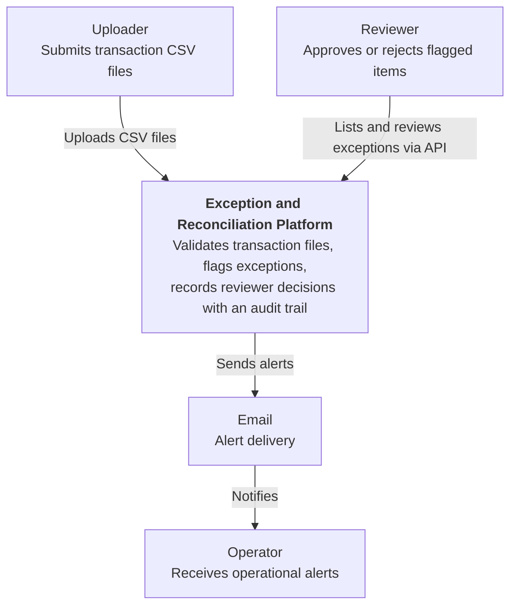
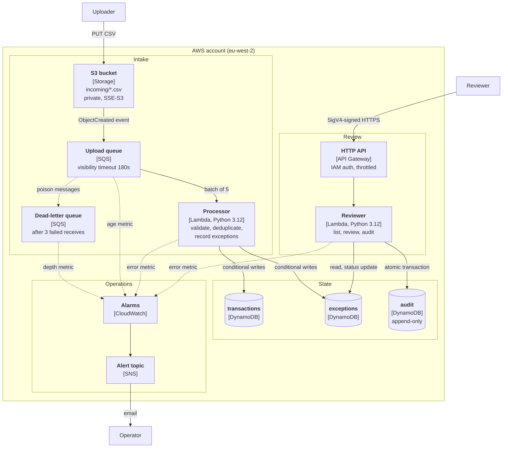

# Architecture

Two views of the system, following the C4 model: system context (who uses it and what it talks to) and containers (the deployable pieces inside it).

## Level 1: System context

## Level 2: Containers

## Key flows

**Ingestion.** An uploader drops a CSV in `incoming/`. S3 emits an event to the upload queue. The processor reads the file, validates each row, and writes clean rows to `transactions` and violations to `exceptions` using conditional writes, so redelivery and re-uploads are safe. A file that fails entirely (for example, wrong headers) is retried and, after three attempts, moved to the dead-letter queue, which raises an alarm.

**Review.** A reviewer sends a signed request to the HTTP API. API Gateway verifies the caller's AWS identity and passes it to the reviewer Lambda. A decision updates the exception and appends an audit event in one DynamoDB transaction. Both succeed or neither does, and a second decision on the same exception is rejected.

## Trust boundaries

- The S3 bucket and queues are private. Only the processor role can read from `incoming/` and the queue.
- The only public entry point is the HTTP API, and every route requires a valid AWS signature.
- The reviewer role cannot read S3 or SQS. The processor role cannot touch the audit table.